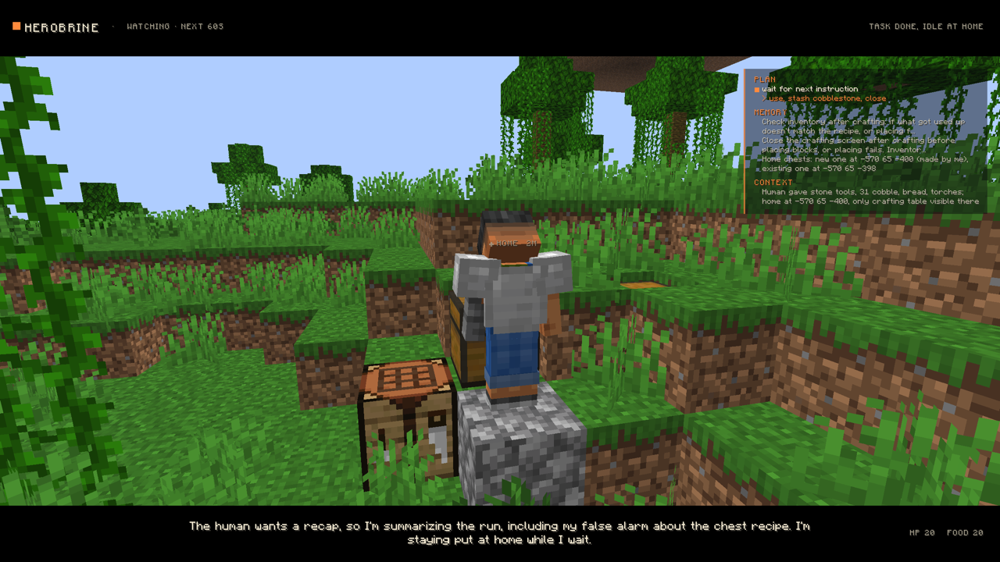
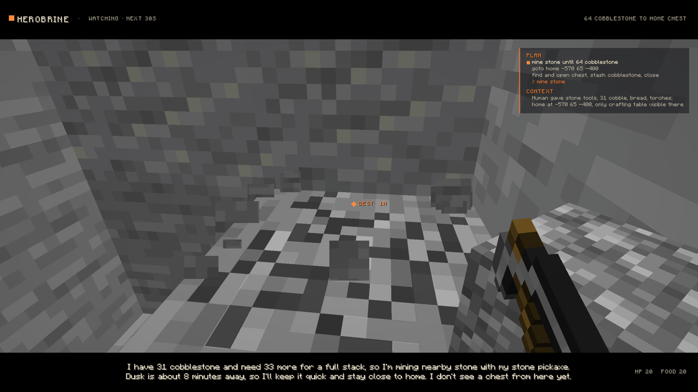
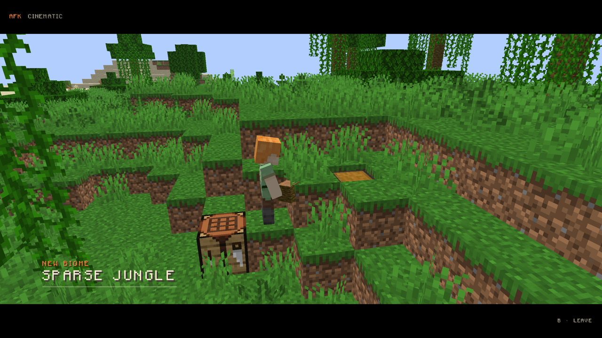
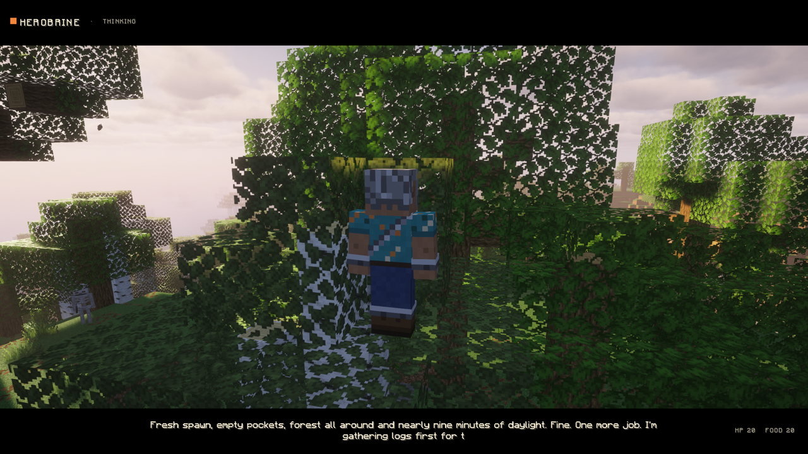
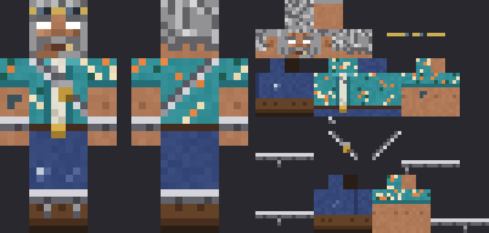
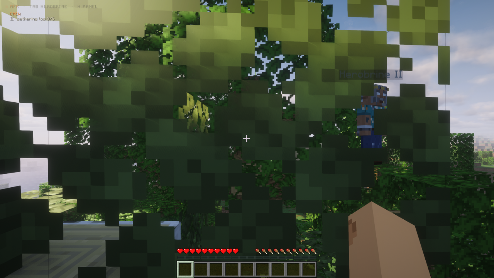
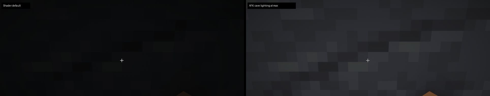

# AFK

**Tap Tab and Herobrine takes over.** AFK is a Minecraft modpack (Java 26.3, Fabric) where an AI agent, signed in with *your own* Claude or ChatGPT account, takes control of your character and plays for you, filmed by a cinematic camera. Tap Tab again and you're back.

> Pre-release (0.3.0). Built and tested on macOS with Minecraft 26.3. Expect rough edges.



| In a tight shaft the camera cuts to first person | Press B for the cinematic camera while you play |
|---|---|
|  |  |

## What it does

- **Tab takeover.** Tap Tab: Herobrine has your body and your mouse stops steering it. Tap again: it switches off at once and Baritone pauses mid-task, so it resumes where it left off next time. Holding Tab still shows the player list.
- **Herobrine is retired, and you keep dragging him back.** While he has your body you wear his skin (only you see it): grey mutton chops, white eyes, aviators on his forehead, an open Hawaiian shirt in Steve's cyan, a big belt buckle, and iron shackles with broken chain on his wrists and ankles. The chains rattle when he takes over, and he talks like a weathered old stuntman: "I was retired. Fine. One more job."

  | He takes over: "Fine. One more job." | His skin |
  |---|---|
  |  |  |
- **The crew: `/agent`.** In a world running on your computer, `/agent` calls a helper: another Herobrine with his own body, who appears next to you in a puff of smoke. `/agent chop 32 logs` calls one for a job. Helpers play fair like Herobrine (they walk, only go for blocks they can see, mine at a player's speed and need the right tool), and they gather, farm and replant, tunnel, guard you, craft the basics, use chests and hand you what they collected. Any job can run on a loop ("keep the farm going"). A crew brain runs the team: it splits big jobs, the helpers message each other and Herobrine in your chat, it can call in more helpers when a job needs them (up to five), and everyone shares one playbook, so a lesson one of them learns helps all of them. Talk to them with `@II get wood`, `@crew come here`, or `/agent tell II <task>`.

  
- **Stop button.** **Delete** (or the red button in the panel, `/agent stop`, `/afk stop`) stops everything at once: Herobrine gives your body back, and every helper drops his job and his loops.
- **The AFK panel.** Press **H** for one small column of switches: Herobrine, Stop everything, call or dismiss helpers, cinematic camera, shaders on or off, the 24 fps ladder and discovery moments.
- **Plays legitimately.** Herobrine only knows what a player in your body could see or hear: ores and mobs in line of sight, usable blocks it can see (chests, beds, tables), your inventory, health and coordinates, and the tab list. For ores and anything else hidden, Baritone is locked to legit mining: it only digs what has been seen and otherwise tunnels to find more. Trees, crops and common ground are in plain sight, so it simply walks to those. Commands that search hidden blocks are blocked.
- **Real hands.** It does what a player does with the mouse and inventory, the way a player does it (in reach, in view, looking at it):
  - crafts with the recipe book, placing a crafting table when a recipe needs one and picking it back up afterwards
  - opens chests and furnaces, moves exact amounts in and out, and closes them
  - places blocks, uses doors and beds, and sleeps through the night
- **Reflexes.** While it has control, the body reacts without waiting for the AI: it hits hostile mobs in reach with your best weapon, runs from a creeper about to blow, eats when hungry, and puts on armor it is carrying.
- **Cinematic camera.** While Herobrine plays, the view becomes a film: over-the-shoulder, side tracking, low hero angles, orbits, wide, crane and top-down shots, fly-bys from a spot ahead on its route, and close-ups of the block being mined. The camera rides on the player with spring smoothing, the lens pushes in slowly, and letterbox bars frame it. In tunnels and thick foliage it cuts to a first-person shot. It stays out of solid blocks and keeps a clear line to you, so it never works as x-ray.
- **Cinematic moments for you.** Press **B** while exploring for the same camera while you keep playing. Firsts get a lower-third title card: a new biome, a new creature, your first of an ore, a big cave, the Nether, the End. The big ones also get a short cinematic when you're not busy. `/afk moments off` turns this off.
- **See what it's thinking.** A small panel shows its live commentary, its plan, what it remembers and what it can see. Markers in the world show its route, destination, home, the ores and mobs in its sight, and the block it's mining.
- **Talk to it in plain words.** In chat, start with `hb` (`hb mine some iron`, `hb what did you do?`). While Herobrine has control, everything you type goes to it; start with `!` to talk to the server. It answers in your chat, takes or hands back control when you ask, and runs a server command only when you explicitly asked for one. Voice works through macOS Dictation into the chat box.
- **`/do <task>`.** Give it a task and it takes over: `/do get me 20 logs`, `/do farm the wheat`. `/do stop` takes you back.
- **It remembers what you were doing.** While you play, AFK keeps a short local diary: blocks broken and placed, containers opened, where you travelled, your chat and commands, and what you gained or used. When you hand over, Herobrine reads it and continues your work.
- **Crafting and chests by typing.** Every container screen gets an "Ask Herobrine" box. In your inventory or at a crafting table: `3 pickaxes`, `16 torches`. In a chest: `sort`, `sort potions`.
- **It learns.** Herobrine keeps a playbook of *lessons* (written after every death or failure) and *skills* (ways of doing things it worked out or you taught it), and reads it at the start of every session. It doesn't retrain a model; it gets better by following its own growing notes.
- **Keeps 24 FPS or better.** When frames drop, AFK walks down a ladder one step at a time: first your shader pack's own lower quality profiles (for example Complementary's High, Medium, Low, Potato), then shorter render distance, fewer far entities and no clouds, and only then shaders off. With headroom it climbs back. It never goes above your own settings and puts them back when you leave, even after a crash. `/afk perf off` disables it.
- **Looks good by default.** Complementary Unbound shaders with Iris and Sodium, Faithful 32x, Fresh Animations, Fast Better Grass, Low On Fire and Default Dark Mode, plus max brightness and no Darkness-effect pulsing.
- **You can see in caves.** Shader packs mostly ignore the Brightness slider, so caves go nearly black. AFK turns the pack's own cave lighting to its maximum, once (Complementary, BSL and Photon). Change it back in the shader's settings and AFK leaves it alone.

  

## Install

You need:

1. **Minecraft Java 26.3** and a launcher that imports Modrinth packs (Modrinth App or Prism Launcher), or the official launcher with Fabric.
2. **Node.js 22 or newer** (`brew install node`).
3. **One sign-in for Herobrine**, either:
   - **Claude**: [Claude Code](https://claude.com/claude-code), signed in (`claude auth login`), or
   - **Codex**: the Codex CLI (`npm install -g @openai/codex`), signed in (`codex login`). Codex support is new and less tested.

Then download the `.mrpack` from [Releases](../../releases) and import it in your launcher. In the game, `/afk login` opens the sign-in for you, and `/afk provider codex` switches to Codex.

Herobrine's brain (`afk/brain/agent.mjs` in the game folder) starts automatically when you join a world. Settings are in `config/afk.json`.

## Controls

| | |
|---|---|
| Tap **Tab** | Herobrine takes over / gives you back control |
| Hold **Tab** | Player list (as usual) |
| **B** | Cinematic camera while you play |
| **H** | The AFK panel |
| **Delete** | Stop everything (Herobrine and every helper) |
| `/agent`, `/agent <task>` | Call a helper (singleplayer or Open to LAN) |
| `/agent tell <name> <task>`, `@II <task>`, `@crew <task>` | Give helpers something to do |
| `/agent list`, `/agent dismiss [name\|all]` | See the crew / send helpers away (they drop what they carry) |
| `/afk shaders on\|off` | Shaders on or off |
| `hb <anything>` in chat | Talk to Herobrine |
| `/do <task>`, `/do stop` | Give a task / take control back |
| `/afk status`, `/afk login` | Status, sign-in |
| `/afk perf on\|off`, `/afk moments on\|off` | Performance ladder, discovery moments |

## Privacy

Everything runs on your computer. The mod talks to Herobrine's brain over a local-only port (`127.0.0.1:25599`) that rejects requests from web pages. Your activity diary, discoveries and Herobrine's playbook are files in your game folder (`afk/`). The only thing that leaves your machine is what Herobrine sends to your own Claude or Codex account to decide what to do.

## Honest limits

- Herobrine fights only what comes into reach: it can't chase, shoot a bow or block. It can't trade, enchant, brew or build structures yet.
- It can only craft recipes your recipe book has unlocked, like clicking them yourself.
- Baritone's route planner knows the layout of terrain the game has loaded (that's how pathfinding works). Finding ores is legit, but routes aren't limited to what's been seen.
- On a shared server or Realm, Herobrine plays as you, so follow the server's rules about automation.
- Helpers only exist in worlds running on your computer (singleplayer, or Open to LAN for friends who also have AFK): a server or Realm decides what lives in its world. They know a small recipe book (the survival basics), and they can't build structures, trade, enchant or brew. If you later open the world without AFK, the helpers are gone.
- A custom AFK shader pack is planned; research notes are in [docs/shader-research.md](docs/shader-research.md).

## Build from source

```bash
JDK_HOME=/path/to/jdk-25 mod/build.sh                               # mod/build/afk-<version>.jar
python3 pack/build-pack.py mod/build/afk-0.3.0.jar <owner>/<repo>   # dist/AFK-<version>.mrpack
dev/test-client.sh /tmp/afk-test "New World"                        # offline test copy of the game
```

The mod compiles straight against the game jar (26.x ships readable names), so no Gradle is needed. It expects Fabric API, Baritone and Iris jars in your `mods` folder.

`dev/test-client.sh` starts an offline copy of the game in its own folder with a copy of one of your singleplayer worlds (the original is never touched) and test hooks on port 25600, so the mod can be driven and screenshotted by script without the launcher or an account.

## Credits

AFK links to these projects; nothing of theirs is redistributed in this repository. Thank you to their authors.
[Fabric](https://fabricmc.net) · [Baritone](https://github.com/cabaletta/baritone) (LGPL-3.0) · [Sodium](https://modrinth.com/mod/sodium) · [Iris](https://modrinth.com/mod/iris) · [Entity Model Features](https://modrinth.com/mod/entity-model-features) · [Entity Texture Features](https://modrinth.com/mod/entitytexturefeatures) · [Mod Menu](https://modrinth.com/mod/modmenu) · [Complementary Shaders](https://modrinth.com/shader/complementary-unbound) · [BSL](https://modrinth.com/shader/bsl-shaders) · [Photon](https://modrinth.com/shader/photon-shader) · [Faithful](https://modrinth.com/resourcepack/faithful-32x) · [Fresh Animations](https://modrinth.com/resourcepack/fresh-animations) · Fast Better Grass · Low On Fire · Default Dark Mode.
The cinematic camera's shot language follows the film camera in [Icarus](https://justkeepflying.com).

AFK's own code is MIT licensed.
