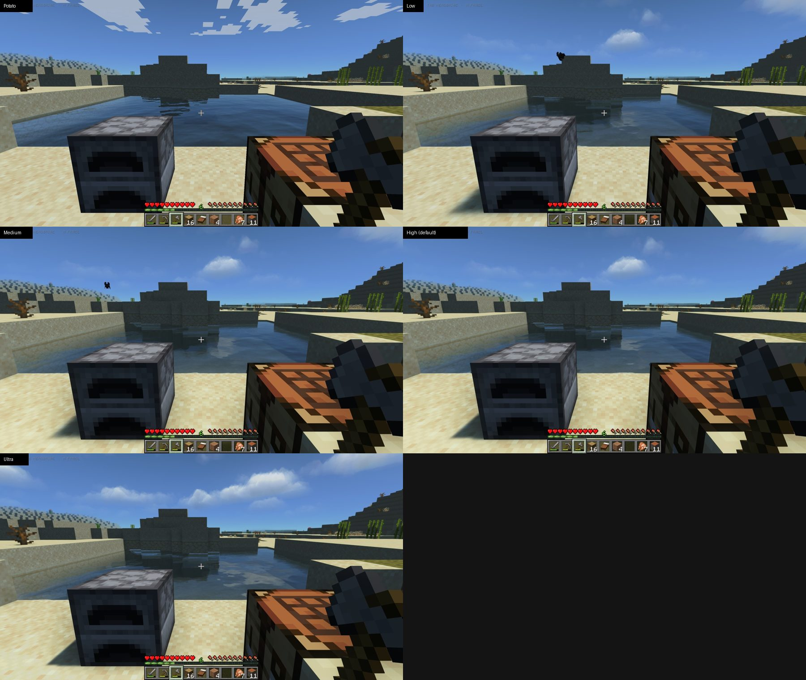
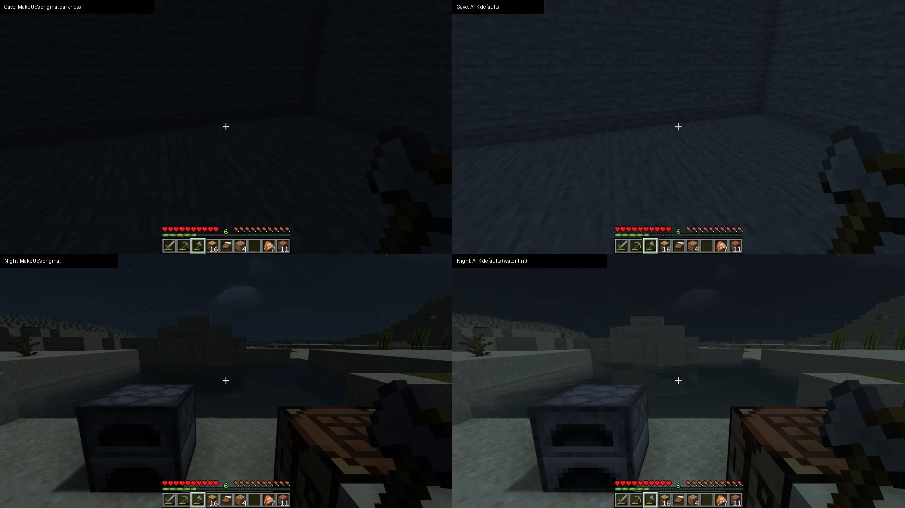

# AFK Shaders

The shader pack for the AFK modpack: an Iris / OptiFine-format pack for Minecraft 26.3 that keeps caves and nights readable, works on Apple Silicon Macs, and bends its own quality to hold the frame rate.

It is a modified version of **[MakeUp Ultra Fast](https://github.com/javiergcim/MakeUpUltraFast)** 9.6 by Javier Garduño (KDXavier), chosen as the base because it is the fastest of the mainstream packs, it already has soft shadows, screen-space water reflections, auto-exposure, volumetric light and TAA, its GLSL stays within what macOS's OpenGL 4.1 allows, and its licence (LGPL-3.0-or-later) allows modifying and redistributing it. MakeUp on [Modrinth](https://modrinth.com/shader/makeup-ultra-fast-shaders) · [GitHub](https://github.com/javiergcim/MakeUpUltraFast). Thank you, Javier.

## Install

Copy this folder (or `AFK-Shaders.zip` from the AFK modpack) into `shaderpacks/`, then pick it in Options > Video Settings > Shader Packs. It needs Iris 1.11.7 or newer for Minecraft 26.3.

## What AFK adds to MakeUp

- **One quality setting.** Five profiles, Potato, Low, Medium, High (default) and Ultra, each set the master `AFK_TIER` option and MakeUp's own quality options together. Any option can still be changed by hand afterwards. AFK's performance governor steps through these profiles in order when frames drop.
- **Frame-time adaptation inside the pack.** A smoothed frame-time uniform (`afkPerf` in `shaders.properties`) falls from 1 to 0 between 45 and 28 fps. It scales the ray-march steps of water reflections and volumetric light, shadow filter taps, cloud and AO samples, and the resolution of the volumetric light pass (0.5x to 1x of the screen, depending on the tier). Quality drops within about half a second and comes back over a few seconds, in four steps so the image doesn't shimmer. `AFK Adaptive` turns it off.
- **Mac-safe on every tier.** OpenGL 4.1 only: no compute shaders, SSBOs or image load/store, and every program stays under the 16-sampler limit of Apple's drivers.
- **Brightness floor.** `Cave Brightness` (the least light a block gets where the sky can't reach), `Night Brightness` (a moonlit ambient outdoors) and `Dark Exposure` (how far auto-exposure opens up in the dark). 0 / 1.00 give MakeUp's original look.
- **AFK filmic tonemap.** Highlights roll off without changing hue and the darkest tones keep a little more detail. MakeUp's curve is still an option.
- **Shadows that stay out of caves.** Soft shadows filter with one to four rings of rotated taps (by tier and frame time). Sunlight needs real sky access, and past the edge of the shadow map surfaces fall back to a sky-light estimate instead of being fully lit, so far tunnels and overhangs don't glow. Light shafts fade out when you're underground.
- **Border fog.** Terrain fades into the sky behind it before the edge of render distance (or Distant Horizons' distance), so chunk borders never show.
- **Water.** Gentle vertex waves on top of MakeUp's normal-mapped waves, a tint that stays visible at night and in the dark, and reflections that fall back to the sky when the reflected ray leaves the screen instead of smearing a stray pixel.
- **26.x depth.** Minecraft 26.x renders with reverse-Z. Iris 1.11.7 hands packs forward-Z depth (checked in game with the `AFK_DEBUG_DEPTH` view), so MakeUp's depth math holds; a runtime guard (`afkDepthReversed`) flips depth back to forward-Z in the shared linear-depth helper if a later Iris or a LOD mod passes reverse-Z through. Details in `shaders/lib/afk.glsl`.

The AFK code lives in `shaders/lib/afk.glsl`, `shaders/common/afk_vl_*.glsl` and the `deferred1` programs; changes inside MakeUp's files are marked `AFK:`.

## Licence

AFK Shaders is a modified version of MakeUp Ultra Fast and, like it, is licensed under the **GNU Lesser General Public License v3.0 or later** (`LICENSE`), which builds on the GNU General Public License v3.0 (`COPYING`). MakeUp's original readme is kept as `MakeUp-README.md` and its third-party credits as `Credits`. The rest of the AFK repository is MIT-licensed; this folder is not.

No code from Complementary, BSL or Photon is used (their licences don't allow it).

## How it was tested

On an M4 Max MacBook Pro (OpenGL 4.1 Metal), Minecraft 26.3, Fabric, Iris 1.11.7, Sodium 0.9.2, with AFK's offline test client:

- Every tier compiles with no shader errors in the Overworld, and the default tier also in the Nether and the End. `dev/count-shader-samplers.py` on Iris's `patched_shaders` dump: at most 10 samplers in any fragment program (Apple's limit is 16).
- The tiers look different from the same spot (image above).
- With the GPU deliberately loaded (`AFK_DEBUG_STRESS`), `afkPerf` fell to 0 and volumetric light dropped from 0.75x to 0.5x resolution; with the load removed it climbed back (`AFK_DEBUG_PERF` shows both as bars).
- A sealed stone room measured about 2.4 times brighter with AFK's defaults than with MakeUp's original settings, and a moonlit scene about 1.4 times, with the water clearly tinted.

Not tested yet: Distant Horizons and Voxy, Windows and Linux drivers, and long play sessions.

## Debug options (not in the menu)

Set these in `shaderpacks/<pack>.txt` or by editing `shaders/lib/afk.glsl`: `AFK_DEBUG_DEPTH` (depth convention view), `AFK_DEBUG_PERF` (adaptation bars: quality factor, volumetric light resolution, frame time), `AFK_DEBUG_STRESS` (a deliberately slow GPU load).

